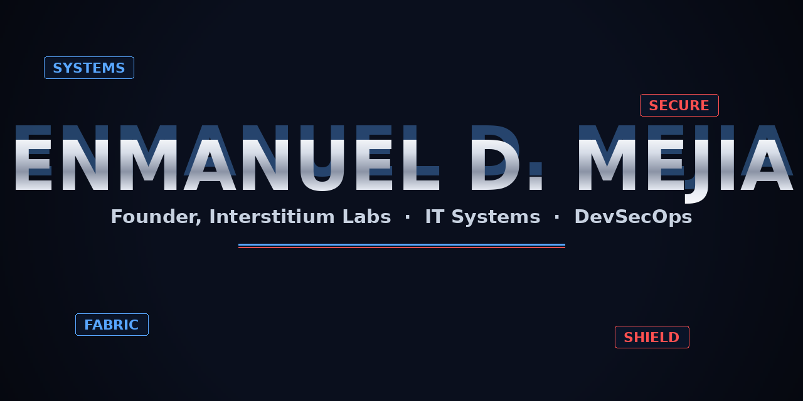

**IT Systems · DevSecOps · Founder, Interstitium Labs**

IT Infrastructure Engineer with five years running IT operations — Windows Server, Active Directory, Hyper-V, SQL Server, networking/VPN. I build independent technical learning resources through Interstitium Labs.

---

## 🛰️ Portfolio

| | |
|---|---|
| **[🌐 Personal portfolio](https://enmanueldmejia.com)** | Selected projects, background, and contact |
| **[🧬 Interstitium Labs](https://interstitiumlabs.dev)** | Independent technical guides, learning resources, Noah tutoring, and a jobs workspace |
| **[⚙️ DevOps SuperLab](https://github.com/EnmanuelMejia/devops-superlab)** | Personal DevOps lab — containers, CI/CD, and IaC study projects with explicit implementation status |
| **[🤖 Print-manufacturing AI architecture](https://github.com/EnmanuelMejia/ai-vision-deck-print-manufacturing)** | Anonymized personal interview proposal — pitch deck + 48-page technical ultraplan |

My labs and proposals demonstrate personal work. They do not represent paid production DevOps employment, commissioned consulting, or vendor certification. CompTIA A+ is my confirmed credential; other certification-prep repositories are study resources.

## 🛠️ Work and study focus

`Windows Server` · `Active Directory` · `Hyper-V` · `SQL Server` · `RHEL` · `Linux` · `Networking/VPN` · `AWS` · `Azure` · `Cloudflare` · `GitHub Actions` · `Python` · `Bash` · `PowerShell` · `Java` · `C#/.NET` · `C/C++` · `SQL`

Currently studying: `Kubernetes` · `Docker` · `Podman` · `Terraform` · `Ansible` · `GCP` · `Jenkins`

My background includes IT support, technical operations, semiconductor manufacturing, and analytics. I apply that troubleshooting and documentation discipline to Linux, automation, containers, and software projects. The repositories distinguish working features, starter configurations, and planned work.

## 📌 Background highlights

- **IT Operations (Data Vimenca)** — Delivered IT services to 1,700+ users leading a 22-person support org in hybrid AWS/Azure; cut manual VoIP/PBX intervention 20% with Python/Bash automation on RHEL; administered Windows Server 2022, Active Directory, DNS, DHCP.
- **Semiconductor Manufacturing (Intel)** — Generated $70M+ in savings co-developing 300mm test-wafer routes (Technology Manufacturing Group Excellence Award); led teams of up to 19 technicians across 200mm/300mm fabs; piloted a fab-wide safety initiative adopted as the factory standard.
- **Cost Analytics (Intel)** — Improved cost accuracy 20% launching the iCOST inventory process; reconciled SOX controls across SQL Server, Oracle Database, and SAP for 140+ analysts; drove software lifecycle changes via SQL scripting and Unix/C++ utilities.
- **IT Labs (Boston University)** — Sustained 99.9% lab uptime across 500+ devices; built the Ubuntu Linux lab image with VMware/VirtualBox; Staff Excellence Award.

## 🔍 Inspect this portfolio

This is a README-only profile repository. Project source lives in the individual repositories linked under Portfolio above — each README states what is working, what is starter configuration, and what is planned.

## 📬 Contact

- **LinkedIn:** [linkedin.com/in/enmanuelmejia](https://www.linkedin.com/in/enmanuelmejia)
- **GitHub:** [github.com/EnmanuelMejia](https://github.com/EnmanuelMejia)
- **Email:** [mejiaenmanueld@gmail.com](mailto:mejiaenmanueld@gmail.com)

Open to IT infrastructure, systems administration, and solutions engineering roles in Orlando, FL.
